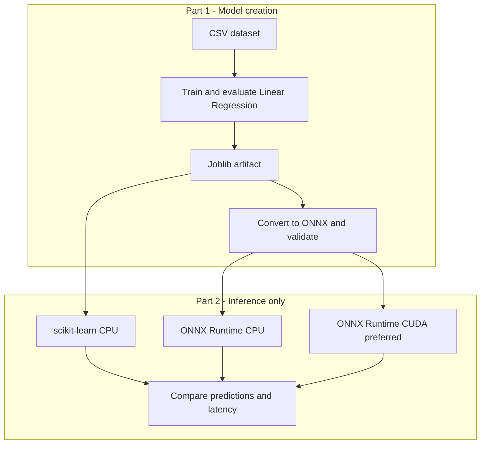

# Understanding ONNX

**Train once. Export once. Execute on different hardware.**

What happens after a machine learning model has been trained? How can it run independently of its training framework? This hands-on tutorial answers these questions using a simple Celsius-to-Fahrenheit regression model. The original synthetic dataset contains 100 records following `F = 1.8 × C + 32`. The simplicity makes the deployment lifecycle easy to understand.

## The learning journey



| Component | Responsibility |
|---|---|
| scikit-learn | Train and execute the original estimator |
| Joblib | Persist the fitted Python estimator |
| skl2onnx | Convert the fitted estimator into an ONNX graph |
| ONNX | Standard model representation with operators, tensors and parameters |
| ONNX Runtime | Execute the graph using execution providers |

## Getting started

Use Python 3.11 in an isolated environment. From the repository root on Windows PowerShell:

```powershell
python -m venv .venv
.\.venv\Scripts\Activate.ps1
python -m pip install -r requirements.txt
```

On Linux/macOS use `source .venv/bin/activate` instead. The CPU tutorial does not require a GPU. Requirements specify package names rather than a tested lockfile; for repeatable environments record installed versions with `python -m pip freeze`.

### Part 1 — Create Joblib and ONNX files

Open [01_create_models.ipynb](part_01_model_creation/01_create_models.ipynb) and run the cells in order, or execute the equivalent script:

```bash
python part_01_model_creation/create_models.py
```

The model learns the coefficient and intercept, is evaluated on a held-out split, serialized to Joblib, converted to ONNX and structurally validated. Both artifacts are generated under `models/`.

### Part 2 — Inference only: CPU and GPU

Open [02_run_inference.ipynb](part_02_model_inference/02_run_inference.ipynb) or run:

```bash
python part_02_model_inference/run_inference.py
```

This part loads existing artifacts, compares predictions and measures mean and P95 latency for batch sizes 1 and 1024. Expected predictions for 0, 25 and 100 °C are 32, 77 and 212 °F, respectively. Numerical equivalence is checked with tolerances, not bitwise equality.

#### Enable NVIDIA GPU inference

Create a separate virtual environment and install `requirements-gpu.txt` instead of `requirements.txt`. Do not install CPU and GPU ONNX Runtime packages together. Check [CUDA/cuDNN compatibility](https://onnxruntime.ai/docs/execution-providers/CUDA-ExecutionProvider.html) for the installed runtime version and GPU. Select the appropriate Jupyter kernel if using notebooks. The GPU environment must also have a scikit-learn version compatible with the generated Joblib artifact.

```bash
python -c "import onnxruntime as ort; print(ort.__version__, ort.get_available_providers())"
```

CUDA must initialize successfully, not merely appear in the provider list. CUDA-preferred sessions can assign some or all nodes to CPU; [profiling](https://onnxruntime.ai/docs/performance/tune-performance/profiling-tools.html) can establish actual operator placement. The tutorial skips unavailable GPU execution instead of reporting CPU fallback as GPU acceleration.

#### Minimal ONNX-only deployment

The ONNX artifact can run without the training framework. In a fresh environment install `requirements-inference-cpu.txt` (or `requirements-inference-gpu.txt` for CUDA), then run:

```bash
python part_02_model_inference/onnx_only.py --device cpu
python part_02_model_inference/onnx_only.py --device gpu
```

The GPU command requires the GPU environment. No Joblib, pandas, scikit-learn or converter is needed for these commands.

## Repository layout

```text
ml-to-onnx-tutorial/
├── data/temperature_conversion.csv
├── models/README.md
├── part_01_model_creation/
│   ├── 01_create_models.ipynb
│   └── create_models.py
├── part_02_model_inference/
│   ├── 02_run_inference.ipynb
│   ├── run_inference.py
│   └── onnx_only.py
├── requirements.txt
├── requirements-gpu.txt
├── requirements-inference-cpu.txt
├── requirements-inference-gpu.txt
└── README.md
```

## Troubleshooting

| Symptom | What to check |
|---|---|
| Model missing | Run Part 1 first |
| Unexpected input type | Use float32 and shape `[batch, 1]` for ONNX |
| CUDA unavailable | Check runtime package, interpreter, drivers and CUDA/cuDNN compatibility |
| Native DLL load failure on Windows | Check Microsoft Visual C++ runtime and required NVIDIA DLLs |
| Joblib loading error | Match scikit-learn versions and regenerate trusted artifacts if necessary |
| GPU is slower | A tiny regression model may not amortize runtime and data transfer overhead |

## Key takeaway

ONNX separates model representation from execution. Portability depends on supported operators and runtime capabilities; performance depends on the workload and hardware. A structurally valid ONNX graph still needs numerical equivalence testing. For real applications, export preprocessing where supported, version artifacts, and measure on representative hardware and workloads.

## References

- [ONNX](https://onnx.ai/)
- [ONNX Runtime Python tutorial](https://onnxruntime.ai/docs/api/python/tutorial.html)
- [ONNX Runtime installation](https://onnxruntime.ai/docs/install/)
- [skl2onnx](https://onnx.ai/sklearn-onnx/)
